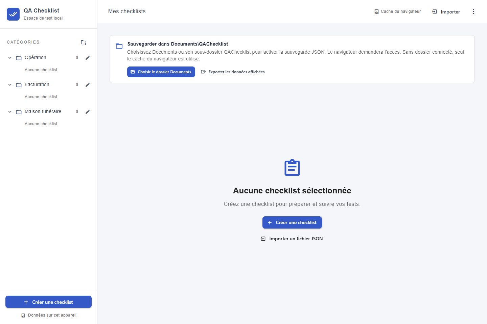

# Livraison et vérifications

Vérifications effectuées le 27 octobre 2026. Application locale uniquement; aucun commit, aucune commande Docker et aucun déploiement effectués.

## Impact

Application Vue 3 et Vuetify en français pour gérer des catégories et des checklists de test. Chaque cas présente son titre, sa description, les résultats attendus et un résultat à trois états. Après choix et autorisation du dossier dans Chrome/Edge, les données sont enregistrées automatiquement dans `Documents/QAChecklist/checklists.json`, avec copie précédente dans `checklists.previous.json`. Le cache du navigateur reste indépendant. Le script PowerShell prépare le déploiement du dernier commit local de `master` dans Docker Desktop, sans backend ni volume de données.

## Résultats

| Vérification                                    | Résultat                            |
| ----------------------------------------------- | ----------------------------------- |
| `npm run lint`                                  | Réussi, ESLint 10                   |
| `npm run type-check`                            | Réussi                              |
| `npm run test`                                  | 42 tests réussis, 4 fichiers        |
| `npm run build`                                 | Réussi, build statique dans `dist/` |
| `npm run format:check`                          | Réussi                              |
| Audit npm après installation                    | Aucune vulnérabilité signalée       |
| Parseur PowerShell du script Docker             | Aucune erreur de syntaxe            |
| Fichiers texte créés                            | UTF-8 et CRLF                       |
| Console du navigateur pendant les vérifications | Aucune erreur ni alerte             |

Les tests automatisés vérifient les imports invalides, les relations entre catégories et checklists, les identifiants en double, les sauvegardes corrompues, les erreurs d’accès et de quota, les limites UTF-8, le rechargement, les résultats et leur remise à zéro. Les tests de dossier couvrent aussi la restauration après effacement du cache et des métadonnées de connexion, la copie précédente, les écritures sérialisées, le dernier état en attente, les échecs d’écriture et de fermeture, le verrouillage, les modifications externes, les conflits de versions, le refus d’autorisation, l’absence de compatibilité et l’annulation du sélecteur pendant un échec de sauvegarde.

Le localStorage, le sélecteur de dossier, les handles de fichiers, les permissions et les métadonnées IndexedDB sont simulés pour ces tests. Aucun accès réel au dossier Documents n’a été effectué. Les tests ne valident donc pas le dialogue natif d’autorisation du navigateur ni les droits réels du dossier Windows : ils doivent être confirmés lors de la première connexion du dossier depuis l’application.

Les vérifications dans le navigateur ont couvert : formulaire avec parent obligatoire, création de checklist, ajout et renommage d’une catégorie, création des cas de test, boutons Réussi et Échoué, conservation après rechargement, remise à zéro confirmée, export JSON téléchargé puis réimporté en ajout, suppression confirmée de la copie et import de remplacement confirmé. Les dimensions testées incluent 1440 × 960, 390 × 844 et 320 × 740, sans débordement horizontal constaté. Les formulaires et le tiroir mobile ont été vérifiés.

Le nouveau panneau de sauvegarde a été contrôlé visuellement dans un aperçu isolé sur le port 4173, aux formats ordinateur 1440 × 960 et mobile 390 × 844 et 320 × 740. Les actions se replient sans débordement horizontal et la console ne signale aucune erreur ni alerte. Les captures montrent l’espace vierge et le bouton initial de connexion du dossier; elles ne représentent pas une autorisation disque déjà accordée. Les données existantes du navigateur de développement sur le port 5173 n’ont pas été modifiées.

Le build et le démarrage Docker n’ont pas été exécutés, à la demande du développeur. La syntaxe PowerShell ne valide pas l’exécution réelle de Docker ou de Nginx. Le premier déploiement exige de commiter les fichiers de l’application sur la branche locale `master`.

## Captures du panneau de sauvegarde

[Vue mobile](screenshots/mobile.jpg)

## Fichiers créés

Ajouts pour la sauvegarde sur disque :

- `src/components/LocalBackupPanel.vue`
- `src/models/storage/DiskBackupState.ts`
- `src/models/storage/ChecklistDirectoryHandle.ts`
- `src/models/storage/ChecklistFileHandle.ts`
- `src/models/storage/ChecklistFolderSnapshot.ts`
- `src/models/storage/ChecklistWritableFile.ts`
- `src/services/checklistFolderService.ts`
- `src/services/checklistFolderHandleService.ts`
- `tests/checklistFolderService.test.ts`
- `tests/checklistFolderStore.test.ts`
- `tests/helpers/fakeChecklistFolder.ts`

Modifications pour cette évolution : `src/store/checklistStore.ts`, `src/views/ChecklistWorkspaceView.vue`, `AGENTS.md`, `scripts/deploy-docker.ps1` (message de fin), `README.md`, `docs/DOCKER.md`, ce rapport et les deux captures ci-dessous. Le Dockerfile et Nginx restent statiques.

Fichiers de l’application initiale :

Configuration et démarrage : `.dockerignore`, `.editorconfig`, `.gitattributes`, `.prettierrc.json`, `eslint.config.js`, `index.html`, `package.json`, `package-lock.json`, `tsconfig.json`, `vite.config.ts`, `public/favicon.svg`.

Application :

- `src/App.vue`
- `src/main.ts`
- `src/router/index.ts`
- `src/styles/main.css`
- `src/views/ChecklistWorkspaceView.vue`
- `src/components/ChecklistEditorDialog.vue`
- `src/components/ParentEditorDialog.vue`
- `src/components/TestCaseEditorDialog.vue`
- `src/components/TestCaseTable.vue`
- `src/store/checklistStore.ts`
- `src/services/checklistJsonSerializer.ts`
- `src/services/checklistStorageService.ts`
- `src/services/jsonFileService.ts`
- `src/models/checklists/Checklist.ts`
- `src/models/checklists/ChecklistDetails.ts`
- `src/models/checklists/ChecklistDocument.ts`
- `src/models/checklists/ChecklistImportMode.ts`
- `src/models/checklists/ChecklistParent.ts`
- `src/models/checklists/ChecklistStorageSnapshot.ts`
- `src/models/checklists/TestCase.ts`
- `src/models/checklists/TestCaseDraft.ts`
- `src/models/checklists/TestCaseStatus.ts`

Tests : `tests/checklistJsonSerializer.test.ts`, `tests/checklistStore.test.ts`, `tests/fixtures/checklistDocument.ts`, `tests/helpers/memoryStorage.ts`.

Docker et documentation : `Dockerfile`, `docker/nginx.conf`, `scripts/deploy-docker.ps1`, `README.md`, `docs/DOCKER.md`, `docs/VERIFICATION.md`, `docs/screenshots/desktop.jpg`, `docs/screenshots/mobile.jpg`.

`AGENTS.md` a été complété avec les règles durables de persistance sur disque, de conservation des fichiers existants et de récupération après nettoyage du navigateur. `.gitignore` est inchangé.
